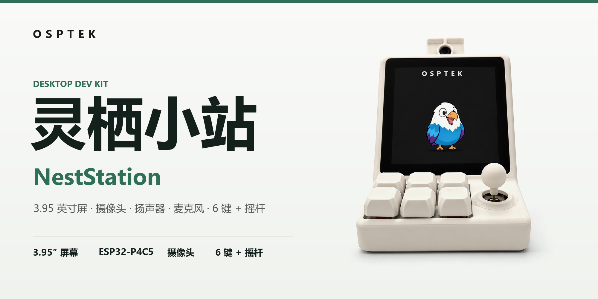
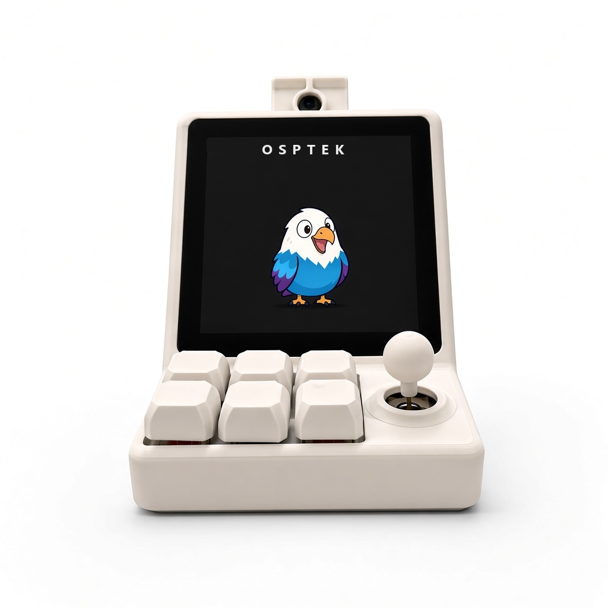
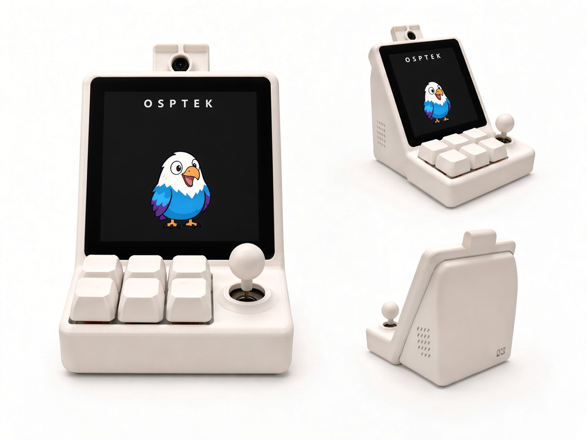

# 灵栖小站 NestStation

OSPTEK 桌面开发套件 · ESP32-P4C5 主控 · 3.95 英寸屏 · 摄像头 · 扬声器 · 麦克风 · 6 键 + 摇杆

  

  
  
  
  
  
  

  <b>简体中文</b> &nbsp;|&nbsp; <a href="README_EN.md">English</a>

## 简介

灵栖小站（NestStation）是 OSPTEK 推出的桌面开发套件，对应仓库 `devkit-p4c5_station_3.95`。

整机基于 [ESP32-P4C5-Module 开发板](https://github.com/osptek/devboard-esp32p4c5_module)，搭载 3.95 英寸屏幕，顶部带摄像头，正面有 6 个机械按键和 1 个摇杆，并带扬声器和板载麦克风。屏幕微微后仰，摆在桌面上抬头即可看见；白色机身，背面留有出音孔。

  

  

> [!NOTE]
> 本文档目前只介绍硬件，固件与软件功能说明后续补充。

## 硬件概览

| 项目 | 说明 |
| :--- | :--- |
| 主控 | ESP32-P4C5（[ESP32-P4C5-Module 开发板](https://github.com/osptek/devboard-esp32p4c5_module)） |
| 显示屏 | 3.95 英寸，微微后仰安装 |
| 摄像头 | 机身顶部 |
| 扬声器 | 主控板 ES8311 编解码 + NS4150 功放（3 W D 类），MX1.25-2P 接口，背面出音 |
| 麦克风 | 主控板板载硅麦 LMA3729T421-OA1 |
| 输入 | 6 个机械按键 + 1 个摇杆 |
| 外壳 | 白色机身 |

主控板的原理图、尺寸、接口与 GPIO 资料见 [ESP32-P4C5-Module 开发板](https://github.com/osptek/devboard-esp32p4c5_module) 仓库。

6 键 + 摇杆的按键板工程（嘉立创 EDA 专业版，2026-11-23）：[hardware/NestStation_Keypad_EasyEDA_20261123.epro2](./hardware/NestStation_Keypad_EasyEDA_20261123.epro2)。

## 相关资料

- [ESP32-P4C5-Module 开发板（主控板资料、原理图、固件）](https://github.com/osptek/devboard-esp32p4c5_module)

## 许可证

本仓库资料（文档、图片等）：[CC BY-NC-SA 4.0](LICENSE)，转载或修改请注明出处，不得用于商业用途，如需商业授权请联系我们。

  <b>O S P T E K</b> &nbsp;·&nbsp; <code>NESTSTATION</code>

