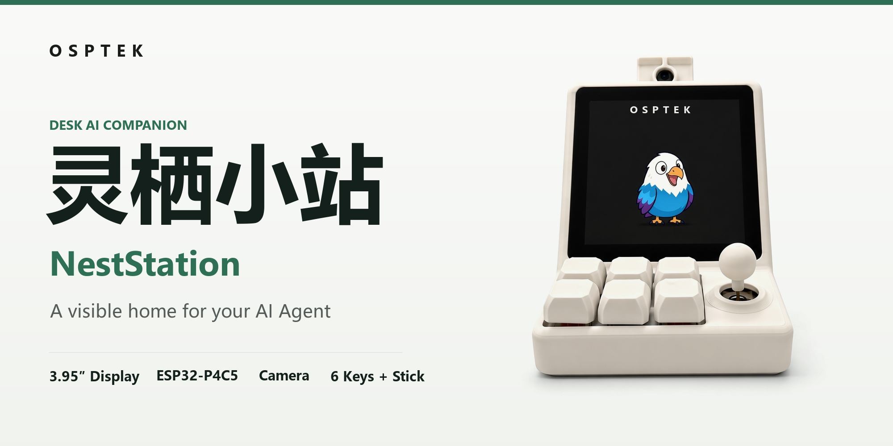
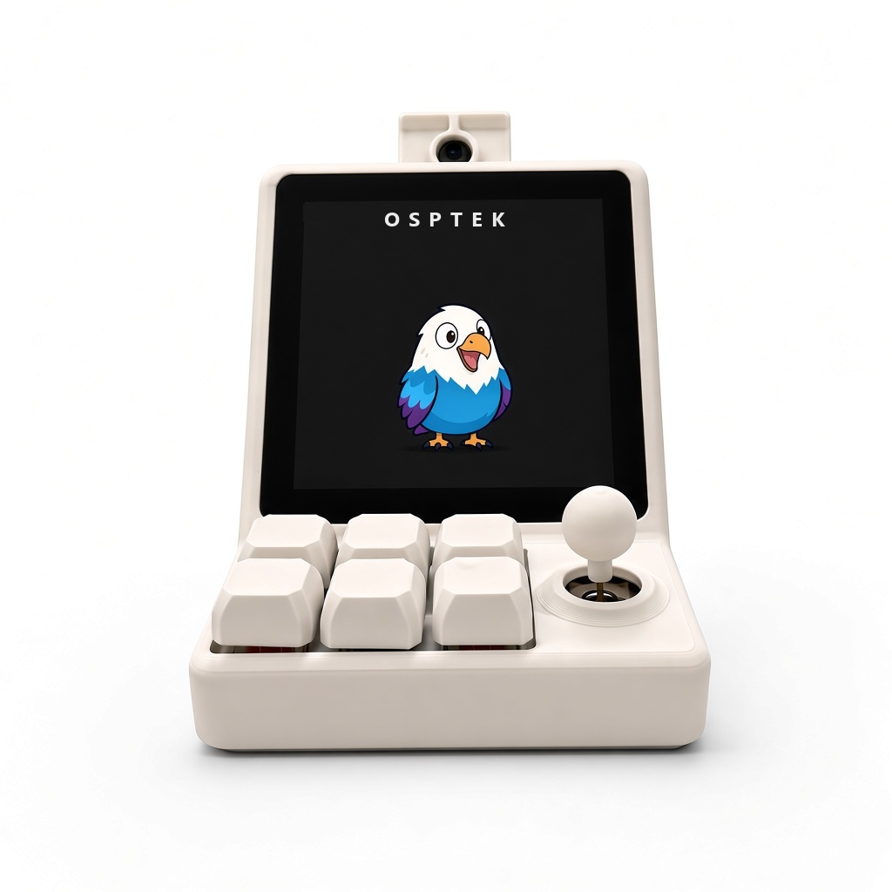
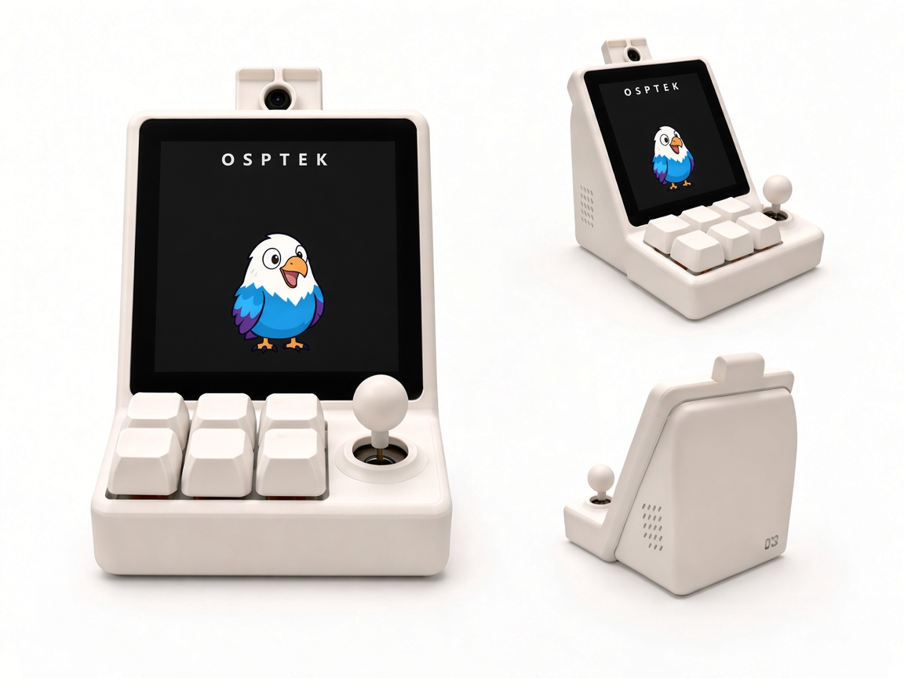

# NestStation (灵栖小站)

OSPTEK Desk AI Companion · ESP32-P4C5 · 3.95-inch display · camera · 6 keys + joystick

  

  
  
  
  

  <a href="README.md">简体中文</a> &nbsp;|&nbsp; <b>English</b>

## Overview

NestStation (灵栖小站) is an OSPTEK desktop development kit; this repository is `devkit-p4c5_station_3.95`.

It is built on the [ESP32-P4C5-Module dev board](https://github.com/osptek/devboard-esp32p4c5_module), with a 3.95-inch display, a camera on top, and six mechanical keys plus a joystick on the front. The screen is tilted slightly backward so it is easy to see on a desk. The body is white, with sound holes on the back.

  

  

> [!NOTE]
> This document covers the hardware only for now. Firmware and software details will be added later.

## Hardware at a glance

| Item | Description |
| :--- | :--- |
| MCU | ESP32-P4C5 ([ESP32-P4C5-Module dev board](https://github.com/osptek/devboard-esp32p4c5_module)) |
| Display | 3.95-inch, mounted with a slight backward tilt |
| Camera | On top of the body |
| Input | 6 mechanical keys + 1 joystick |
| Enclosure | White body |

For the carrier schematic, dimensions, interfaces and GPIO, see the [ESP32-P4C5-Module dev board](https://github.com/osptek/devboard-esp32p4c5_module) repository.

Keypad board project (6 keys + joystick, EasyEDA Pro, 2026-11-23): [hardware/NestStation_Keypad_EasyEDA_20261123.epro2](./hardware/NestStation_Keypad_EasyEDA_20261123.epro2).

## Related resources

- [ESP32-P4C5-Module dev board (carrier docs, schematic, firmware)](https://github.com/osptek/devboard-esp32p4c5_module)

## License

Repository materials (docs, images, etc.): [CC BY-NC-SA 4.0](LICENSE). Credit OSPTEK when sharing or adapting; non-commercial use only. Contact us for commercial licensing.

  <b>O S P T E K</b> &nbsp;·&nbsp; <code>NESTSTATION</code>

